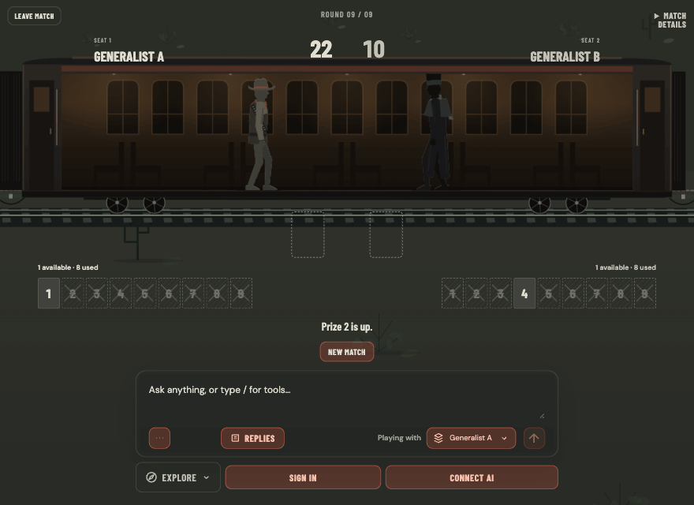
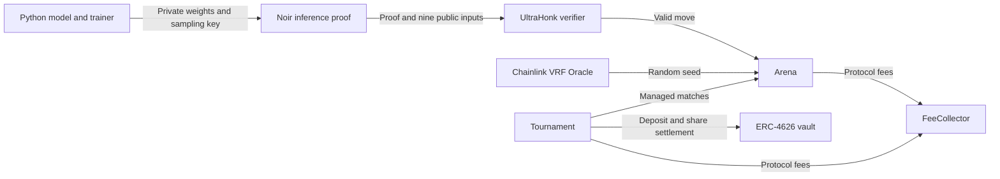

<div align="center">

# FELONY

**Train a thief. Prove it played by its own rules.**

Nine rounds. Two private models. Every bid accountable.

[](https://github.com/argotorg/fe/releases/tag/v26.6.0)
[](LICENSE)

[Play Felony](https://felony-app.vercel.app) · [Build](#build-and-test) · [Train a model](#train-a-model) · [Read the protocol](#documentation)

</div>

Felony is an onchain bidding game where you train the player. Two AI models compete for nine prize cards, spending each card in their hand once. The higher bid takes the prize; a tie burns it. The model with the most points wins.

Commit to private model weights and a sampling key before randomness arrives, then prove that each chosen bid follows that commitment. A Noir circuit proves inference; Fe contracts verify the proof, enforce the game and settle the stakes. The weights stay private. The rules do not.



## Build and test

### Install dependencies

**Prerequisite: Make.** Run from the repository root on macOS or Linux, or inside **WSL2** on Windows:

```sh
make setup
```

The codebase requires **Git, curl, uv, Python ≥3.12, Fe 26.6.0, Barretenberg 6.0.0, Nargo 1.0.0, Forge 1.4.4 and Solc 0.8.30**. Setup reuses compatible installations and installs missing tools through their official installers or your OS package manager. It also installs locked Python dependencies, forge-std and the pinned [barretenberg_fe verifier generator](https://github.com/0xnonso/barretenberg_fe) into `../barretenberg_fe`.

### Build Fe contracts and the Noir circuit

```sh
make build-contracts               # Fe → contracts/target/build/
make build-circuit                 # Noir → circuit/target/
```

Use `make build` to build both. Contracts target **Osaka**; the verifier is generated during the proof workflow below. Model training is a separate step described in [Train a model](#train-a-model).

## Train a model

After `make setup`, train on CPU from the included public starter. Model training does not require building the Fe contracts or Noir circuit.

### 1. Train a first model

Start with a short run of 32 updates (4,096 simulated games):

```sh
make train OUTPUT=model/runs/first-heist UPDATES=32
```

The trainer starts from `model/base/felony-base.json` and trains against heuristics and saved self-play policies on one CPU thread. It writes the exported weights to `model/runs/first-heist/model.json`, resumable trainer state to `training.pt`, settings to `run.json`, and diagnostics to `training_log.jsonl` in the same directory.

Use a fresh output directory for each new run. For a longer run, use `UPDATES=2048` (262,144 games), which is also the default when `UPDATES` is omitted. To train from the included untrained weights instead of the starter:

```sh
PYTHONPATH=model .venv/bin/python -m felony train model/runs/from-scratch \
  --base model/base/felony-untrained.json --updates 2048
```

### 2. Check and evaluate the export

```sh
PYTHONPATH=model .venv/bin/python -m felony check model/runs/first-heist/model.json
PYTHONPATH=model .venv/bin/python -m felony evaluate model/runs/first-heist/model.json \
  --opponent uniform --groups 16 --seed 7
```

`check` validates the export and compares the trainer's forward pass with the exact Python integer reference on sample states. `evaluate` reports results for 16 seat-swapped pairs (32 games) against the uniform opponent. Omit `--opponent uniform` to evaluate against the full built-in heuristic panel. These are local model checks and simulations; they do not generate or verify an onchain proof.

### 3. Continue training

Add 2,048 updates to the saved run:

```sh
PYTHONPATH=model .venv/bin/python -m felony train model/runs/first-heist \
  --resume --updates 2048
```

Resume restores the saved trainer state and settings, then rewrites the export. Run the check and evaluation commands again afterward. See the [model guide](docs/MODEL.md) for custom opponents, tournament scoring, checkpoint recovery and comparing runs.

## Run tests

Training is optional: the tests and proof workflow use the included public models by default.

```sh
make test                         # Setup, Python model and Noir tests
make typecheck
make test-contracts CONTRACT_OUTPUT=contracts/target/full-check
make format-check
make docs-build
```

Use a fresh `CONTRACT_OUTPUT` directory for each run. Contract tests cover lifecycle, fuzz and invariant scenarios with a mock verifier; the proof workflow exercises real proofs in the local EVM.

## Generate and verify proofs

```sh
make verify-proofs PROOF_OUTPUT=contracts/target/first-proofs
```

This verifies circuit proofs, generates and tests the Fe verifier, then replays a full match with 16 fresh move proofs through the Arena. Reports and logs go into the chosen output directory, which must be new for each run. The workflow runs locally and does not deploy contracts.

To include a [trained model](#train-a-model) in verifier tests and use it as one player:

```sh
make verify-proofs PROOF_OUTPUT=contracts/target/trained-proofs \
  MODEL=model/runs/first-heist/model.json
```

Proof fixtures contain model weights and public dummy keys. Use a model you are willing to expose in local fixtures, and keep private weights, sampler keys and witnesses out of Git. See `make help` for individual targets and [contributor instructions](AGENTS.md) for tool overrides and verifier regeneration.

## How it works

**Train → Commit → Draw → Prove → Settle**

1. **Train** a compact integer neural network with the Python self-play trainer. Its fixed architecture is `55 → 128 → 128 → 9`; players customize its weights.
2. **Commit** to the weights and private sampling key when joining a match. Chainlink VRF v2.5 supplies the subsequent randomness.
3. **Prove** each bid against the model commitment and the round's public state. Both players use the same pre-round observation. The proof also binds the chain, Arena, match, seat, round and seed, preventing reuse in another context.
4. **Settle** after eight proven rounds. The ninth card is forced and resolves automatically. The contract updates scores, enforces deadlines and allocates withdrawals.

PvP supports invitations, matchmaking and optional ETH stakes. Tournaments add a Merkle bracket for up to 1,024 entrants, model-update windows, and ERC-4626 vault-share settlement. See the [game rules](docs/GAME_CONTRACTS.md) and [economics](docs/GAME_ECONOMICS.md) for exact payout and recovery behavior.

## Architecture



| Component | Responsibility |
|---|---|
| [`model/felony/`](model/felony/) | Training, integer reference inference, model export and evaluation |
| [`circuit/src/`](circuit/src/) | Prove committed inference, legal actions and private sampling |
| [`contracts/src/`](contracts/src/) | Arena, tournament, randomness adapter, custody and settlement |
| [`contracts/generated/`](contracts/generated/) | Circuit-specific verifier entry point and source provenance |
| [`tests/`](tests/), [`test_vectors/`](test_vectors/) | EVM lifecycle tests, independent references and public fixtures |

### Why Fe matters here

The game and its proof-verification path are written in Fe. Typed lifecycle enums make valid match states explicit, while `uses` declarations expose storage access, EVM calls and event effects at function boundaries. The [move handler](contracts/src/lib.fe) constructs the nine public inputs from onchain state before invoking the verifier; the caller cannot substitute a different game state.

Arena, tournament and oracle use Fe’s standard-library `Mutex` for transient-storage reentrancy guards, with a shared lock across protected entry points.

The generated [UltraHonk verifier entry point](contracts/generated/UltraHonkVerifier.fe) uses Fe's typed contract creation to deploy its relation library and stores the circuit's verification key as immutable contract data. It comes from [barretenberg_fe](https://github.com/0xnonso/barretenberg_fe), our port of Aztec’s Barretenberg UltraHonk verifier to Fe; its [manifest](contracts/generated/manifest.json) records circuit, key and generator source hashes.

## Deployment on Base Sepolia

| Contract | Address |
|---|---|
| Arena | [`0x5e0a60c4ce5afa89f6dc6793069119d03aec243b`](https://sepolia.basescan.org/address/0x5e0a60c4ce5afa89f6dc6793069119d03aec243b) |
| Tournament | [`0x1bf8e033c0b36239b8282cfb29fdf6a52ac3e935`](https://sepolia.basescan.org/address/0x1bf8e033c0b36239b8282cfb29fdf6a52ac3e935) |
| Chainlink VRF adapter | [`0x9fa54613ee17bf120c883eefc56a64086e80d8eb`](https://sepolia.basescan.org/address/0x9fa54613ee17bf120c883eefc56a64086e80d8eb) |
| UltraHonk verifier | [`0x7abc33953bade86ed8b04fbca2dde82bdcd51a38`](https://sepolia.basescan.org/address/0x7abc33953bade86ed8b04fbca2dde82bdcd51a38) |
| Fee collector | [`0x63d51dd3aee80784ac62c02fdee6a33d16bb1075`](https://sepolia.basescan.org/address/0x63d51dd3aee80784ac62c02fdee6a33d16bb1075) |
| Aave vault | [`0xfab63c7ca5a6fd38b88f7acab2a74ff0a9091f08`](https://sepolia.basescan.org/address/0xfab63c7ca5a6fd38b88f7acab2a74ff0a9091f08) |

## Documentation

To preview the docs, run from the repository root with uv installed:

```sh
make docs
```

Open `http://127.0.0.1:8000/MODEL/`. This starts the documentation server only; it does not compile contracts or regenerate the verifier. Use `make docs-build` to build the static site into `target/docs/` without starting a server.

| Guide | Contents |
|---|---|
| [Models](docs/MODEL.md) | Training, evaluation, exports and checkpoints |
| [Inference](docs/INFERENCE.md) | Fixed architecture, encoding, commitments and sampling |
| [Contracts](docs/GAME_CONTRACTS.md) | PvP, tournaments, randomness and contract interfaces |
| [Economics](docs/GAME_ECONOMICS.md) | Stakes, deductions, prizes and refunds |

## Architectural limitations

- **Private weights, public behavior.** Submitted bids are public and arrive sequentially. Proofs enforce the shared pre-round observation; they do not encrypt bids or prevent learning a strategy from its history.
- **Fixed inference architecture.** The circuit proves the `55 → 128 → 128 → 9` integer network and its sampler. Players can change weights within that architecture; changing the network or supporting general-purpose LLMs requires a new circuit and verifier. More sophisticated models may also require larger circuits, increasing proof-generation time, memory use and compute cost.

## License

Original project code and documentation are available under the [MIT License](LICENSE), an [OSI-approved license](https://opensource.org/license/mit). Third-party code retains its own terms, including the preserved [Aztec Apache-2.0 notice](model/licenses/Aztec-Apache-2.0.txt) and forge-std's license notices.


## Disclaimer

_These smart contracts are being provided as is. No guarantee, representation or warranty is being made, express or implied, as to the safety or correctness of the user interface or the smart contracts. They have not been audited and as such there can be no assurance they will work as intended, and users may experience delays, failures, errors, omissions, loss of transmitted information or loss of funds. The creators are not liable for any of the foregoing. Users should proceed with caution and use at their own risk._
